# DevOps Lab Final: Fintech Capstone

**Name:** Chintan Pradhan
**PRN:** 23070122077
**Class:** FLY CSE A

Automated build, test, package and orchestration pipeline for a Node.js `payment-engine` service.

## Index
1. [Git](#1-git)
2. [Jira](#2-jira)
3. [Jenkins](#3-jenkins)
4. [Docker](#4-docker)
5. [Kubernetes](#5-kubernetes)
6. [IaC: Terraform and Ansible](#6-iac-terraform-and-ansible)

## 1. Git
Created `release-v1.0`, committed `version.txt` containing `v1.0-prod-bundle`, merged into `main` with a merge commit, and created the annotated tag `v1.0.0-final`.


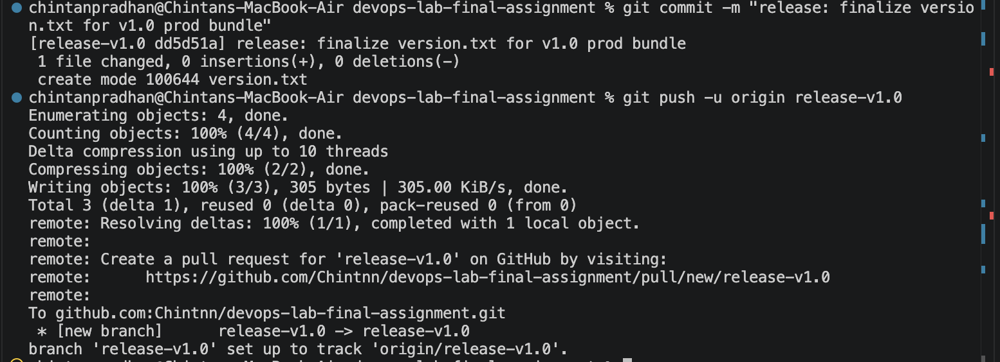
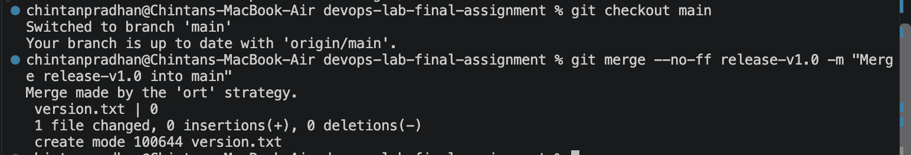
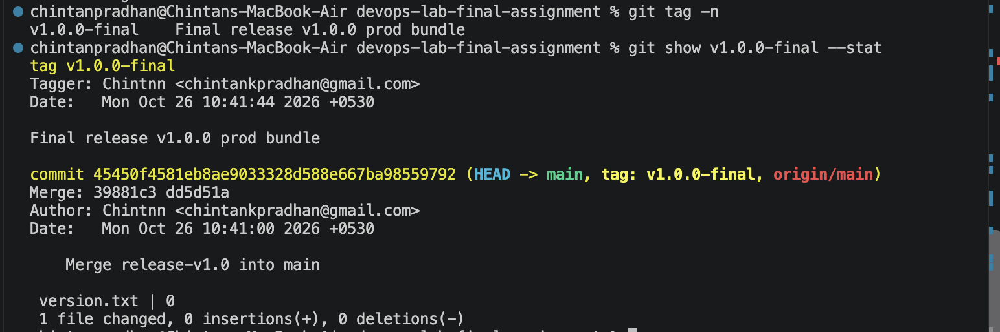
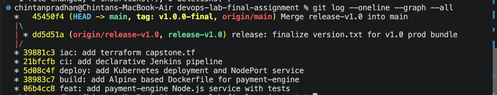
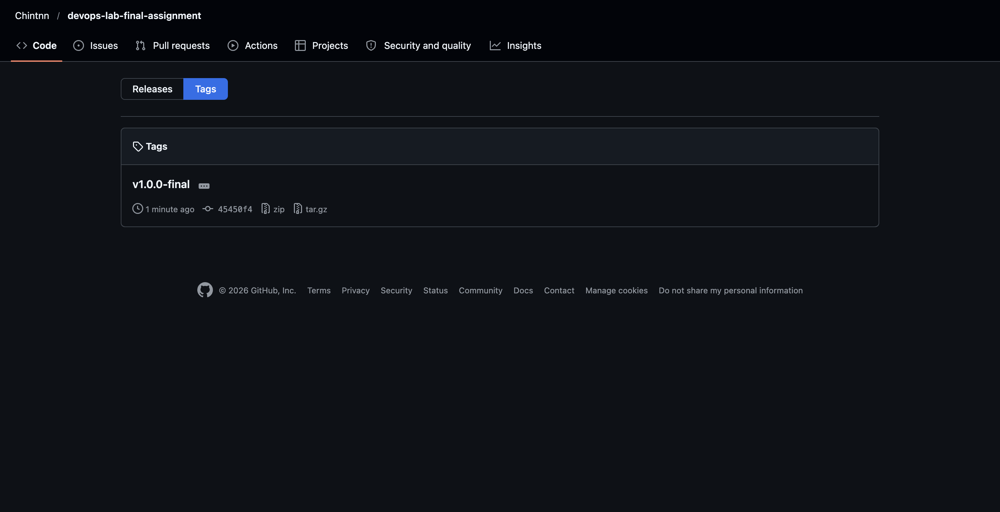

## 2. Jira
Moved all sprint tickets to Done, completed the sprint and reviewed the burndown chart and sprint report.

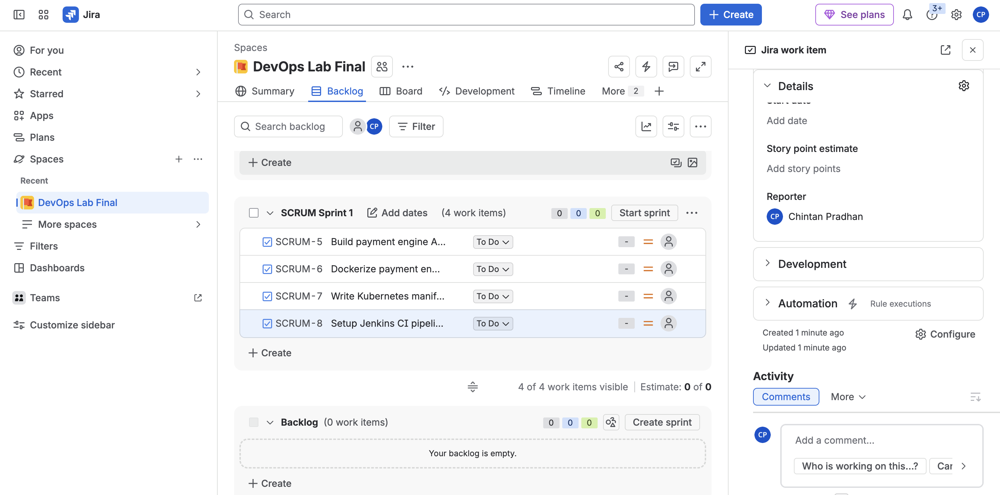
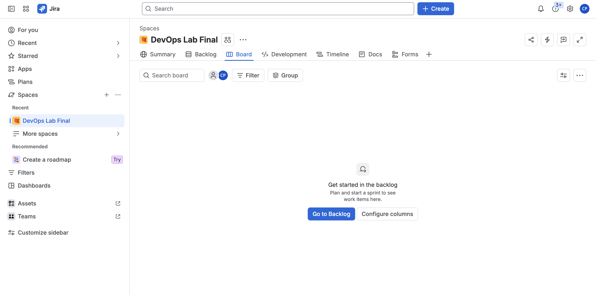
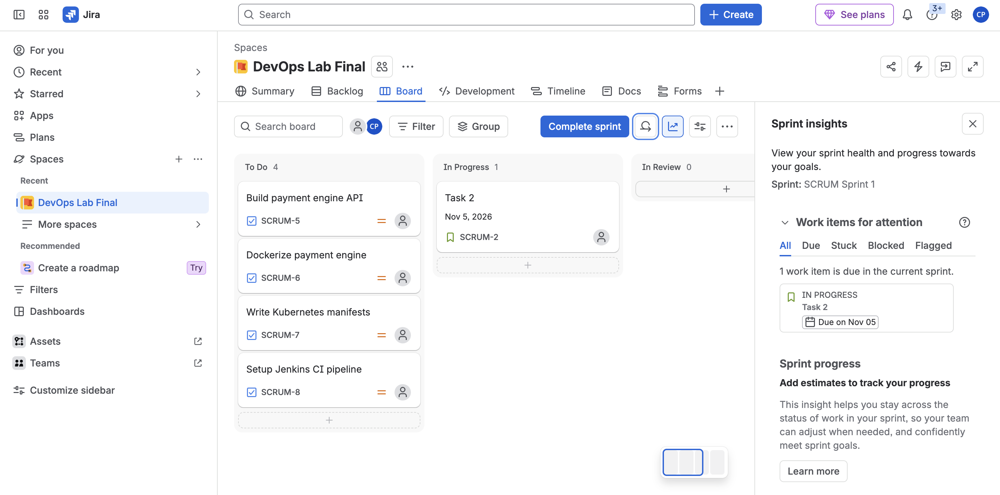
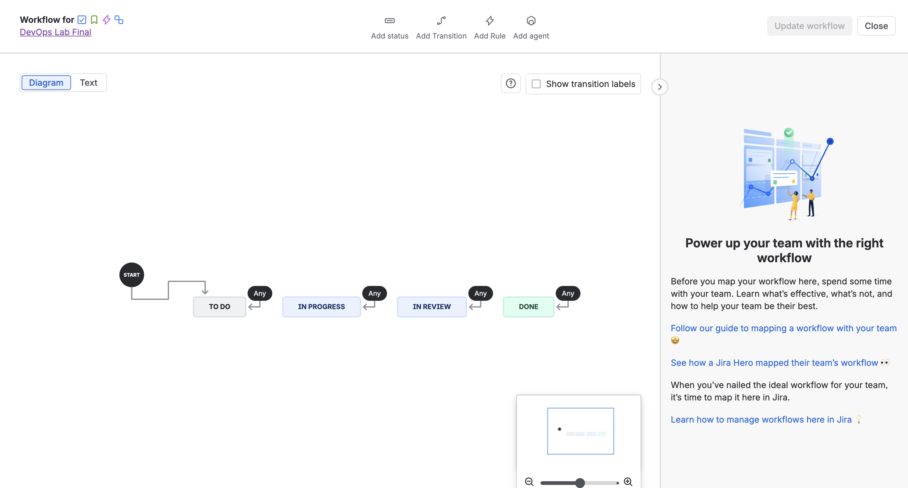

## 3. Jenkins
Declarative pipeline (`agent any`) with stages `Build & Test`, `Docker Packaging` and `Deploy Cluster`, loaded from the `Jenkinsfile` in this repo.
Node.js was installed inside the Jenkins container, and the host Docker socket is used for image builds.
The Deploy Cluster stage verifies the manifests. The actual apply is done from the host in section 5.

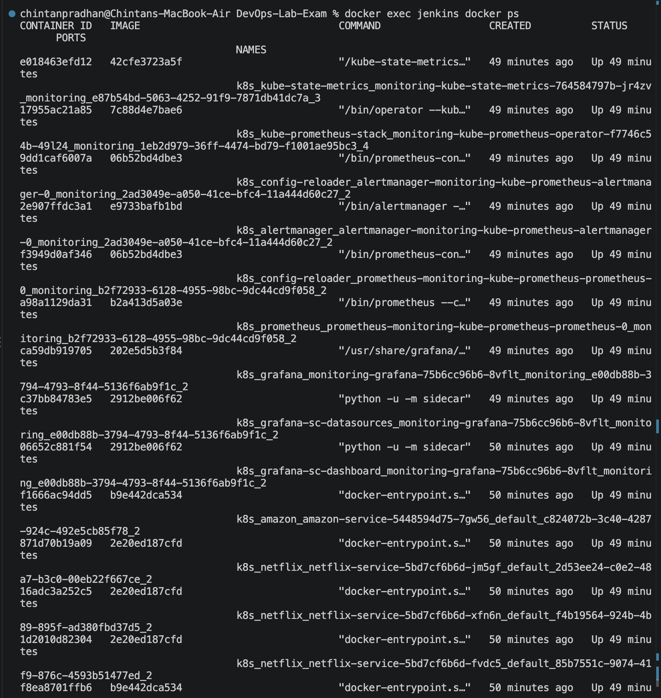
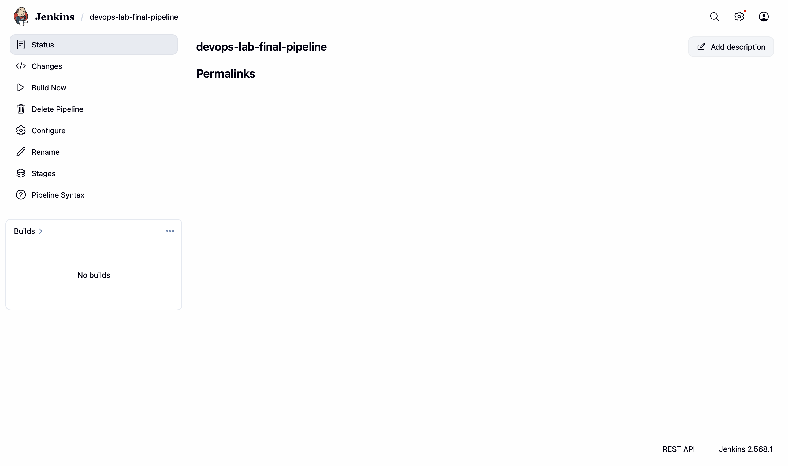
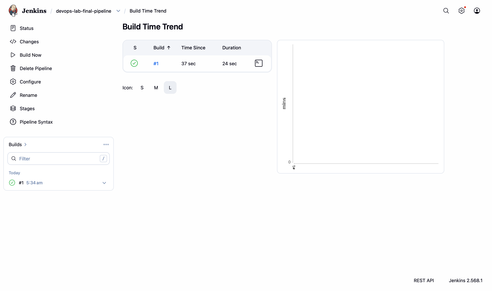
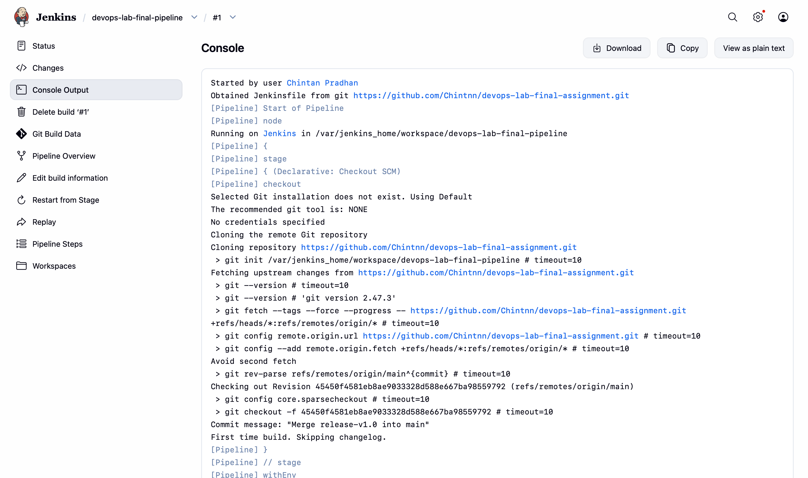

## 4. Docker
Built `payment-engine:capstone` from `alpine`, ran the container `payment-live` and verified it with `docker ps` and the `/health` endpoint.

```bash
docker build -t payment-engine:capstone .
docker run -d --name payment-live -p 3000:3000 payment-engine:capstone
docker ps
```

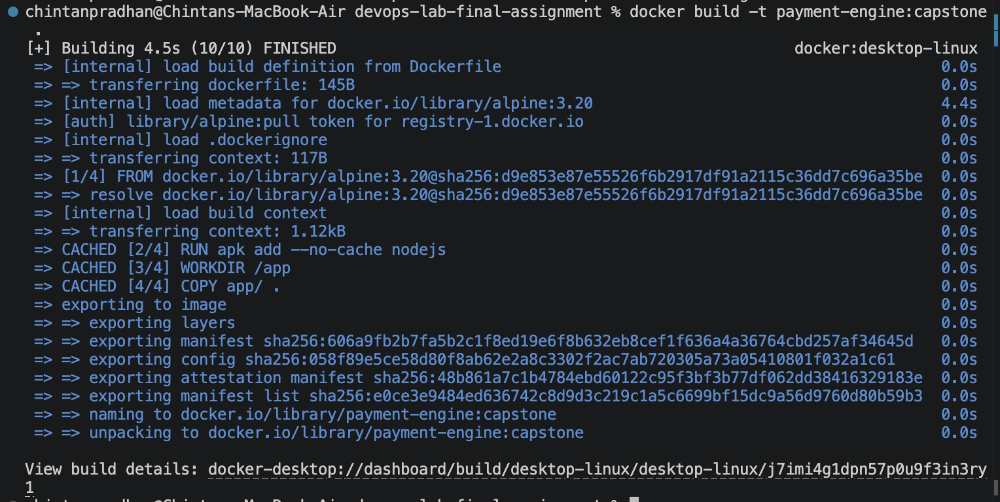
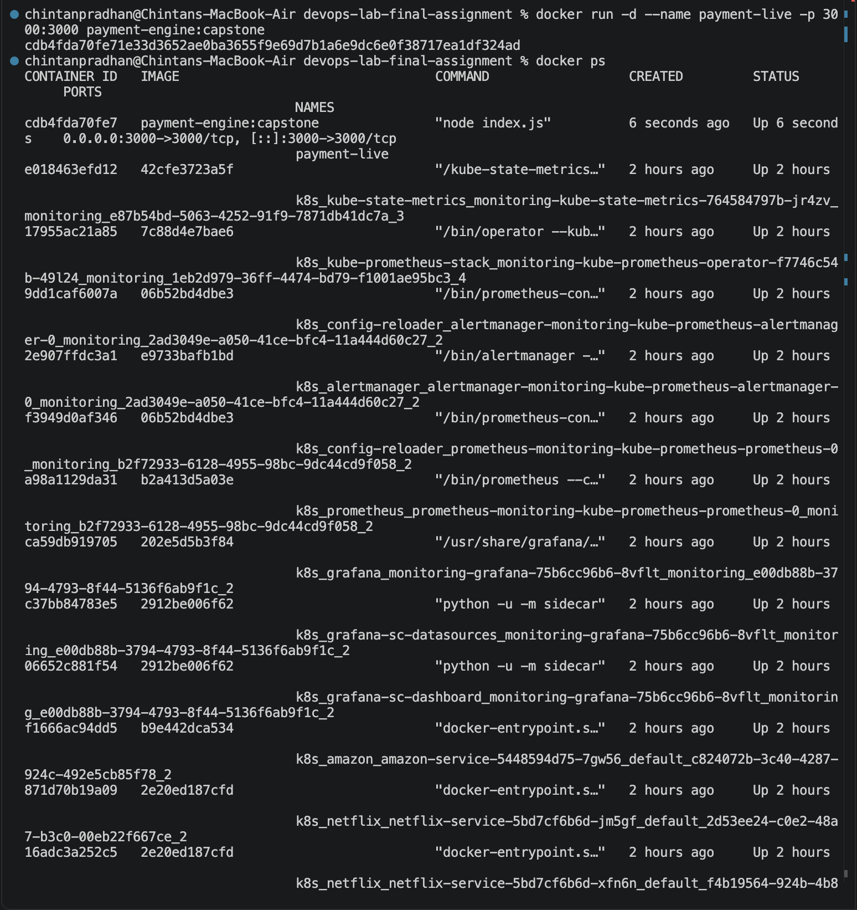
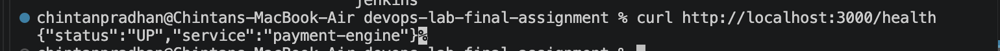

## 5. Kubernetes
Deployed 2 replicas of `nginx:alpine` labelled `tier: backend`, exposed through a NodePort service on 30099.

```bash
kubectl apply -f k8s/deployment.yaml
kubectl apply -f k8s/service.yaml
kubectl get all -l tier=backend
```

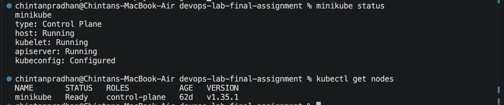
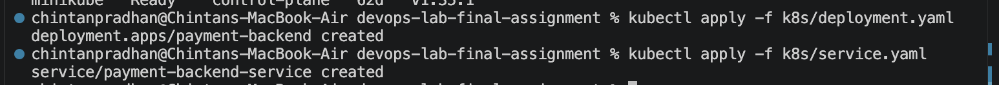
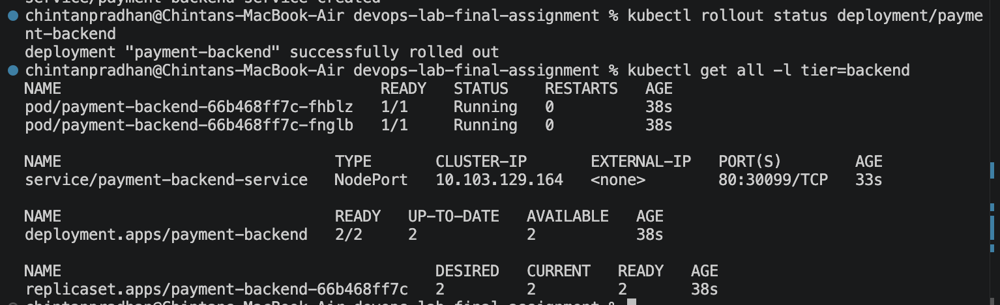
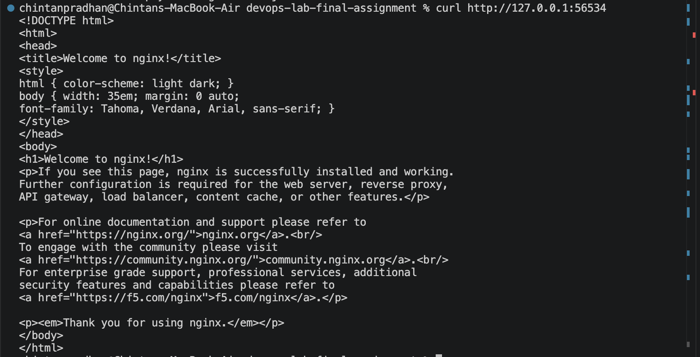

## 6. IaC: Terraform and Ansible
`terraform/capstone.tf` creates `capstone.env` using the `local_file` resource. An Ansible ad-hoc command then inspects its contents.

```bash
terraform init && terraform apply -auto-approve
ansible localhost -m command -a "cat $PWD/terraform/capstone.env"
```

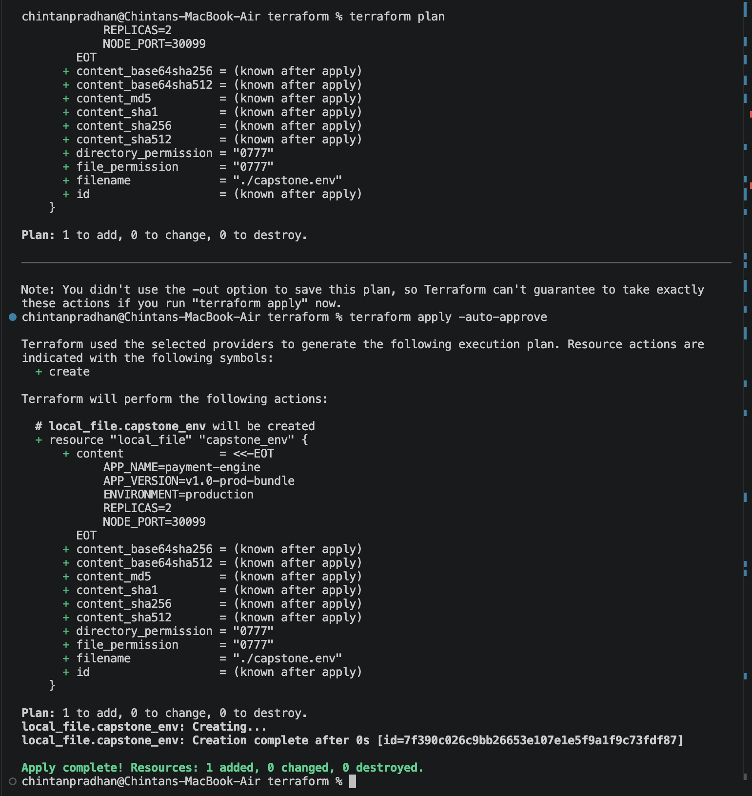
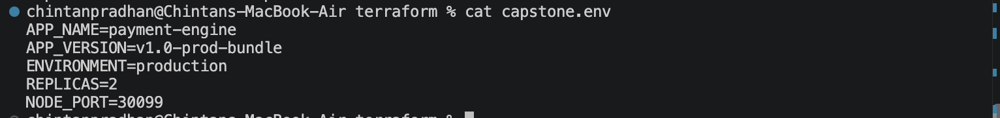
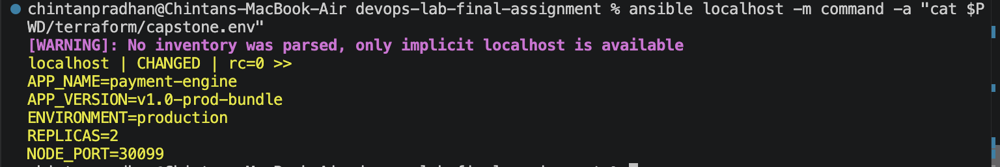

## Project structure
```
app/  k8s/  terraform/  screenshots/  Dockerfile  Jenkinsfile  version.txt  README.md
```